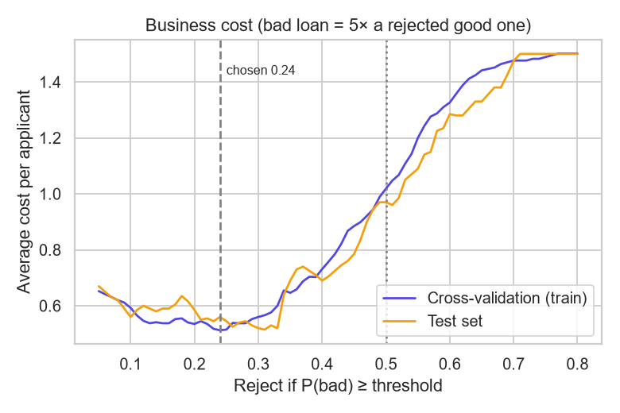

# Credit Risk Scoring

Scores a loan application by the probability that the borrower turns out to be a bad credit risk, with a decision threshold tuned for the real cost of a bad loan.

**[Live demo →](LIVE_DEMO_URL)** — enter an application (checking balance, loan amount and duration, credit history, savings…) and get a risk score with an approve / review / reject suggestion. The model runs in your browser (ONNX Runtime Web), no server needed.



## Results

Held-out test set (20%, 200 applicants, 60 of them bad risks):

| Metric | Score |
|---|---|
| ROC-AUC | **0.785** |
| Accuracy @ 0.5 | 75.0% |
| Recall (bad) @ 0.5 | 40.0% |
| Recall (bad) @ 0.24 (cost-optimal) | **85.0%** |
| Precision (bad) @ 0.24 | 43.2% |
| Avg. cost per applicant — approve everyone | 1.50 |
| Avg. cost per applicant @ 0.5 | 0.97 |
| Avg. cost per applicant @ 0.24 | **0.56** |

Stratified 5-fold cross-validation on the training set (800 applicants); the SVC is tuned with `GridSearchCV` inside every fold (nested CV):

| Model | ROC-AUC | F1 @ 0.5 | Accuracy |
|---|---|---|---|
| **Random Forest** (chosen) | 0.794 | 0.462 | 75.6% |
| Gradient Boosting | 0.784 | 0.500 | 74.6% |
| Logistic Regression | 0.776 | 0.514 | 74.6% |
| SVC (tuned: RBF, C = 3, γ = 0.03) | 0.775 | 0.496 | 75.5% |

All four models are within ~0.02 ROC-AUC of each other (fold-to-fold standard deviation 0.04–0.06): with 1,000 applications, the data is the limit, not the algorithm.

## Cost-sensitive threshold

A bad loan that gets approved is assumed to cost **5×** more than turning away a good customer (lost principal vs lost interest). With calibrated probabilities the break-even point is P(bad) = 1 / (1 + 5) ≈ 0.17. Random-forest probabilities are not perfectly calibrated, so I chose the threshold empirically: the value that minimises average cost on **out-of-fold training predictions** → **0.24** (the test set was not used for this choice).

At 0.5 the model lets 60% of bad borrowers through. At 0.24 it catches 85% of them; it also rejects more good applicants (accuracy drops to 62%), but the expected cost per applicant falls from 0.97 to 0.56 — and from 1.50 if every application were approved. **Accuracy is the wrong metric for this problem.** In the demo, scores below 0.24 are “approve”, 0.24–0.5 “review”, above 0.5 “likely reject”.

## Key findings

- **Checking-account balance** is the strongest signal: 49% of applicants with a negative balance were bad risks vs 12% of those with no checking account at all.
- Longer and larger loans are riskier; a high installment-to-income rate adds risk.
- Credit history behaves counter-intuitively: “critical account” customers have a *low* bad rate (17%) — they already passed a stricter screening (a selection effect typical of historical lending data).
- Dropping the sensitive attributes (sex / marital status, foreign-worker status) and a few weak ones costs almost nothing: Logistic Regression CV ROC-AUC 0.789 with all 20 attributes vs 0.783 with the 13 used here.

## Approach

1. **Decoding** — the raw file uses codes like `A11`, `A34`, `A65`; each is mapped to its meaning from the UCI documentation (e.g. `A11` → “< 0 DM”, `A65` → “Unknown / no savings”). Target: 1 = bad credit risk.
2. **Feature choice** — 13 attributes a loan officer would enter; sensitive attributes left out.
3. **Pipeline** — `ColumnTransformer` (scaling for numbers for the linear / kernel models, one-hot encoding for categories) + model in one scikit-learn `Pipeline`.
4. **Model selection** — Logistic Regression, SVC (RBF / linear kernels, C and γ grid-searched, Platt-scaled probabilities via `CalibratedClassifierCV`), Random Forest and Gradient Boosting compared with stratified 5-fold CV.
5. **Threshold** — cost-optimal cut-off from out-of-fold predictions, then one final evaluation on the untouched test set.
6. **Deployment** — the full pipeline is exported to ONNX and verified against scikit-learn before shipping to the static web app.

## Project structure

```
├── notebook.ipynb     # decoding, EDA, feature choice, model comparison, cost analysis (with outputs)
├── train.py           # reproducible training + ONNX export
├── export_utils.py    # ONNX export / verification helpers
├── requirements.txt
└── web/               # static demo deployed on Vercel
    ├── index.html, app.js, style.css
    ├── model.onnx     # exported pipeline
    ├── meta.json      # form schema, metrics, comparison
    └── assets/        # charts
```

## Run locally

```bash
pip install -r requirements.txt
python train.py                         # downloads data, trains, writes web/model.onnx
python -m http.server 8000 -d web       # open http://localhost:8000
```

## Tech

Python · pandas · scikit-learn · matplotlib/seaborn · skl2onnx · ONNX Runtime Web · Vercel

**Dataset:** [Statlog (German Credit Data), UCI](https://archive.ics.uci.edu/dataset/144/statlog+german+credit+data) — 1,000 loan applications from the 1970s, amounts in Deutsche Mark.
